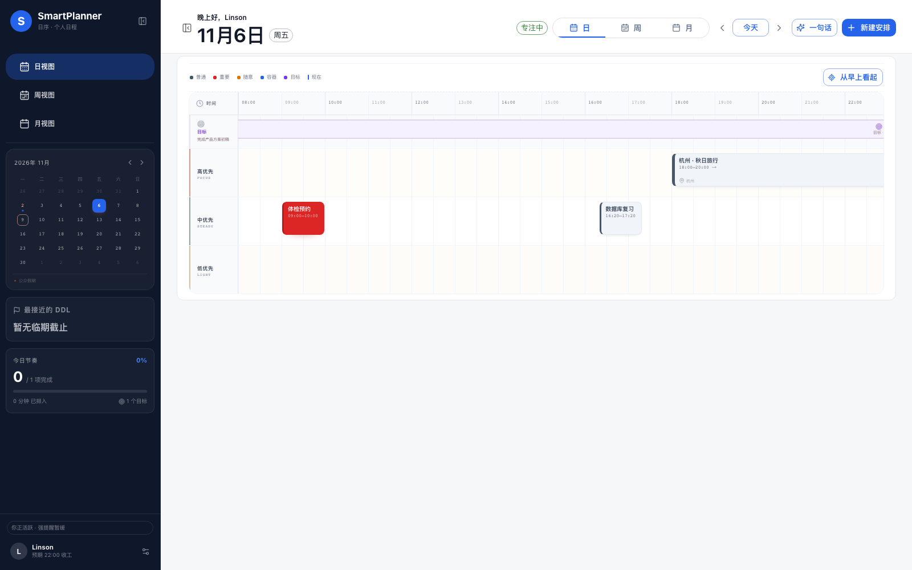
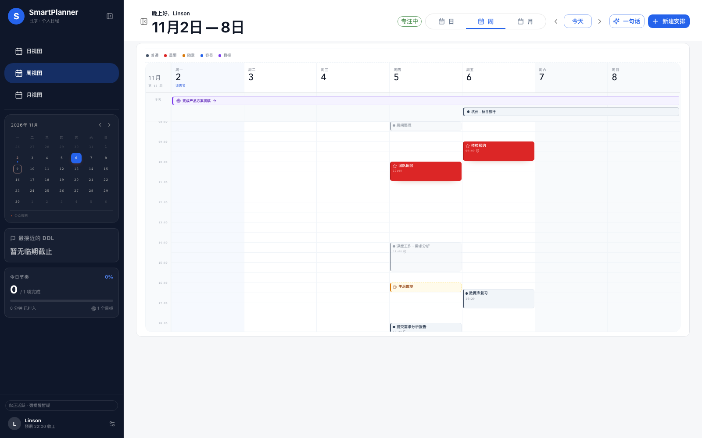
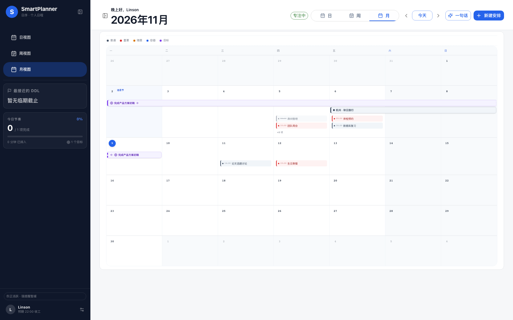
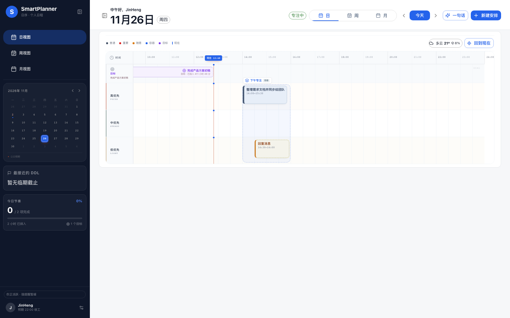
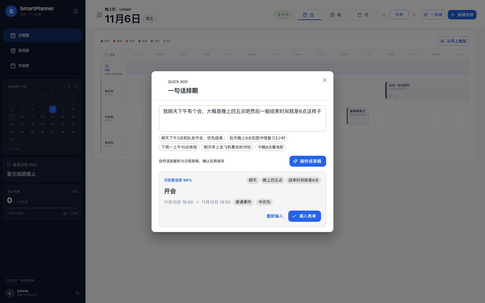

# SmartPlanner

SmartPlanner 是一个面向个人的日程管理 Web 应用，采用 Next.js + Material UI、Spring Boot、FastAPI 和 MySQL 构建。项目以日、周、月三种视图组织时间，重点处理冲突、提醒、并行任务和重新安排。

## 功能

- **日视图**：横向时间轴 + 高/中/低优先级泳道，容器事件包裹子事件。
- **周视图和月视图**：七天时间轴、月历、跨天事件、节假日与补班标记。
- **事件管理**：创建、查看、编辑、完成、删除；支持普通、重要、随意、容器、目标五种类型。
- **冲突检测**：保存后检查时间重叠，并提供整体后移、前置提前、整体提前或后续顺延方案；只有用户确认后才会应用。
- **DDL 与提醒**：侧栏 DDL 加急框、预期收工时间、浏览器活跃状态、软提醒与强提醒。
- **天气与一句话排期**：15 天天气预报、天气敏感事件提醒；中文自然语言输入可解析为日程草稿，并直接创建或填入表单。
- **交互**：日视图拖拽改期、可收起侧栏。

## 技术栈

| 层 | 技术 |
| --- | --- |
| 前端 | Next.js 15、React 19、TypeScript、Material UI 9、Emotion |
| 后端 | Java 21、Spring Boot 3.5、Spring Data JPA |
| 排期引擎 | Python 3.13、FastAPI、Pydantic |
| 数据库 | MySQL 9 |
| 移动端 | Flutter、Material 3 |
| 测试 | pytest、JUnit、Vitest、Flutter Test、JMeter |

前端和 Java API 独立构建，通过 `NEXT_PUBLIC_API_BASE_URL` 直连，CORS 由 Java 配置。Python 引擎和 MySQL 只由 Java 访问。移动端为 Flutter 骨架，复用同一套 Java API。

UI 组件、图标来源与完整配色表见 [docs/UI-DESIGN.md](docs/UI-DESIGN.md)。

## 界面

### 日视图



### 周视图



### 月视图



### 容器事件

容器宽度对应真实时间范围，子事件可以并行放在容器内。



### 一句话排期



## 移动端骨架

`mobile/` 是 Flutter 初始化骨架，包含 Material 3 应用外壳、今天/周视图/设置三个入口、事件模型、HTTP 客户端和今天事件列表。

```bash
cd mobile
flutter pub get
flutter test
flutter run --dart-define=SMARTPLANNER_API_BASE_URL=http://127.0.0.1:8080
```

Android 模拟器访问宿主机时使用 `http://10.0.2.2:8080`。

## 快速开始

环境要求：

- JDK 21+
- Maven 3.9+
- Node.js 20+ 和 pnpm
- Python 3.11+
- Flutter 3.24+（仅移动端）
- MySQL 8+

```bash
cd SmartPlanner
./scripts/dev.sh
```

打开 <http://127.0.0.1:3001>。

首次启动会在 `.runtime/mysql/data` 初始化项目专用 MySQL，并创建 `smartplanner` 数据库和同名用户；数据库为空时会写入一组演示数据。

手动启动：

```bash
# MySQL
./scripts/mysql.sh start

# 排期引擎
cd engine
.venv/bin/uvicorn app.main:app --host 127.0.0.1 --port 8000

# Java API
cd backend
mvn spring-boot:run

# Web
cd web
pnpm install
pnpm dev
```

主要端口：

| 服务 | 地址 |
| --- | --- |
| Web | http://127.0.0.1:3001 |
| Java API | http://127.0.0.1:8080 |
| Python 引擎 | http://127.0.0.1:8000 |
| MySQL | 127.0.0.1:3308 |

常用环境变量见 `.env.example` 和 `web/.env.example`。

## 目录

```text
SmartPlanner/
├── backend/                  # Java API
│   └── src/main/java/com/smartplanner/
│       ├── controller/
│       ├── service/
│       ├── domain/
│       ├── repository/
│       └── dto/
├── engine/                   # Python 排期引擎
│   ├── app/rules.py
│   ├── app/holidays.py
│   ├── app/weather.py
│   ├── app/nlp.py
│   └── tests/
├── web/                      # Next.js + MUI
│   ├── app/
│   ├── components/
│   ├── lib/
│   └── tests/
├── mobile/                   # Flutter 移动端骨架
│   ├── lib/
│   └── test/
├── tests/jmeter/             # JMeter 压测计划
├── scripts/                  # 启动、停止、冒烟、全量测试
└── docs/                     # API、架构、schema、测试说明
```

## 测试

```bash
# Python
cd engine && .venv/bin/pytest

# Java
cd backend && mvn test

# 前端
cd web && pnpm test

# 完整冒烟（需要服务已启动）
./scripts/smoke.sh
```

当前测试结果：

- Python：38 passed
- Java：11 passed
- Vitest：17 passed
- Flutter：1 passed
- 冒烟：18 checks

详细说明见 [docs/TEST-REPORT.md](docs/TEST-REPORT.md)。

## 说明

- 当前为单用户版本，没有登录和账号体系；数据使用固定用户 `userId=1`。
- 天气来自 Open-Meteo，无需 API Key；网络不可用时隐藏天气信息，不影响日程功能。
- 一句话排期采用本地规则解析，不依赖外部服务；可直接创建或填入表单后再保存。
- 浏览器强提醒依赖页面心跳；关闭页面后不会继续接收提醒。
- 跨时区、重复日程和桌面安装包不在当前版本范围内。
