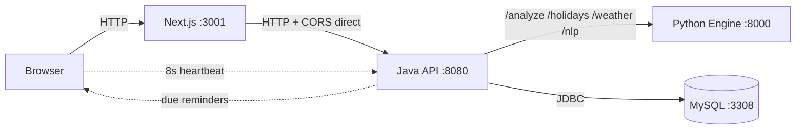
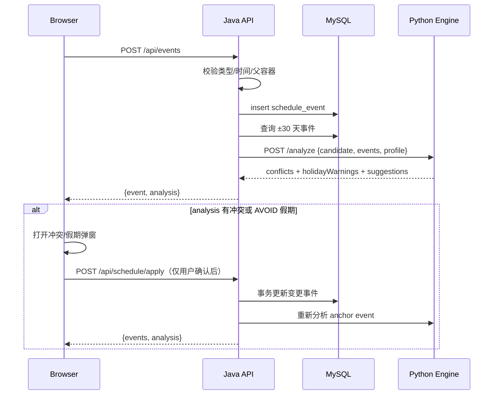
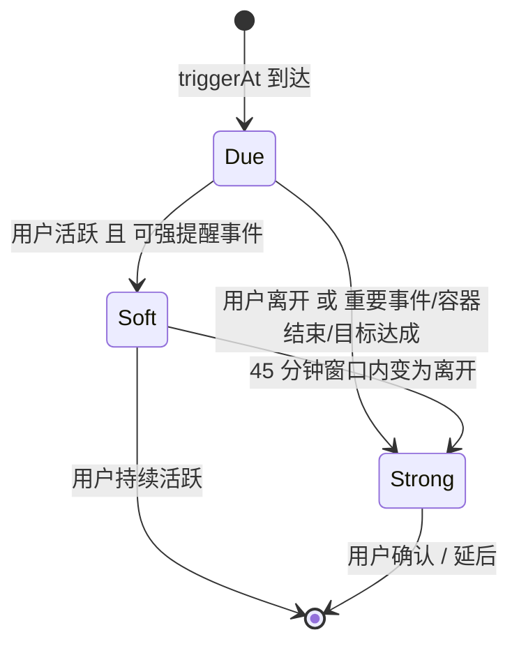
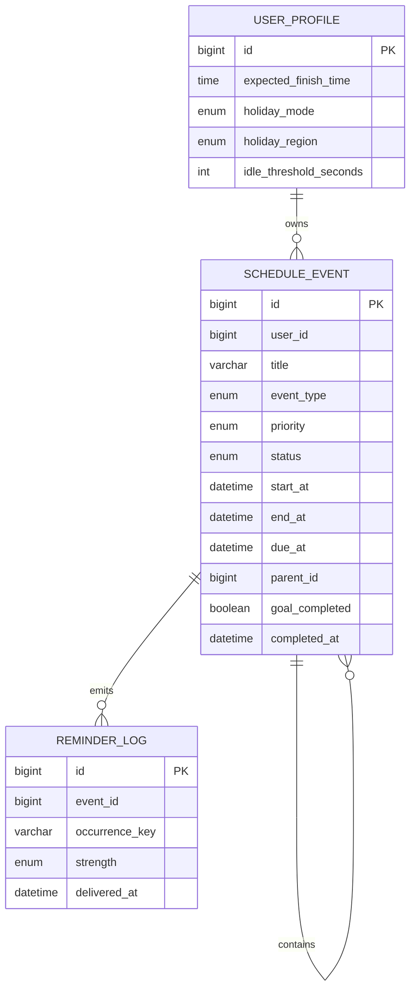

# 架构与规则说明

## 1. 组件

| 组件 | 技术 | 职责 |
| --- | --- | --- |
| Web | Next.js 15 / React 19 / TypeScript / Material UI | 日/周/月三视图、事件抽屉、冲突弹窗、提醒宿主、设置、活跃心跳、天气、NLP、拖拽、主题 |
| API | Java 21 / Spring Boot 3.5 / Spring Data JPA | REST、校验、事务、用户偏好、DDL 概览、提醒投递、presence、天气/NLP 聚合、调用引擎 |
| Engine | Python 3.13 / FastAPI / Pydantic | 冲突检测、节假日日历、重排建议、DDL 缓冲提示、天气适配、中文解析 |
| DB | MySQL 9.7 | 事件、用户偏好、提醒投递日志 |

### 为什么 Python 不直接访问数据库

Python 只接收候选事件、已有事件和用户偏好，返回纯数据；所有写入都由 Java 在一个事务中完成。这样做的好处：

- 规则可以脱离数据库用 pytest 覆盖；
- 用户确认前不会产生副作用；
- Java 的校验、权限和审计只有一个入口；
- 后续可以把引擎换成在线模型或独立服务而不改表结构。

## 2. 创建事件的时序

关键点：

- 事件**先保存再分析**，因此弹窗文案是“已经保存”。这样即使引擎宕机，用户也不会丢失输入；
- 引擎不可用时，`analysis.engineAvailable=false`，前端仍保留 CRUD，并提示稍后重试；
- 智能调整不会自动执行；`/api/schedule/apply` 只会应用前端传来的具体 changes。

## 3. 冲突规则

### 时间范围

- 普通事件：`[startAt, endAt)`；
- 进行中的目标：`[startAt, now)`，并且作为背景目标不参与冲突；
- 已完成目标：类型已变成 `CONTAINER`，按容器处理；
- 已取消 / 已完成事件不参与冲突；
- 多天事件可以跨日期。

### 允许重叠

两个事件允许重叠，当且仅当：

1. 其中一个或两个是**进行中的目标**（背景事件）；
2. 它们是**同一个容器的子事件**（`parentId` 相同）；
3. 一个是容器，另一个是它的直接子事件（互相指向的父子关系）。

其余情况时间相交即冲突。

### 为什么容器不会“吞掉”外部事件

`CONTAINER` 本身表示一段被保留的时间；与容器外的普通事件重叠仍会被报告。只有容器和它自己的子事件之间允许重叠，避免出现“把容器拉满全天就什么冲突都没有”的漏洞。

### 重排建议

| 策略 | 做法 | 适用 |
| --- | --- | --- |
| `SHIFT_LATER` | 保持时长，把候选事件移到冲突之后最近的空位 | 只改当前事件 |
| `TRIM_PREVIOUS` | 把与候选事件尾部相撞的前一个事件整体提前 N 分钟 | 单冲突、短重叠 |
| `SHIFT_EARLIER` | 保持时长，把候选事件整体提前到冲突之前 | 当天更早有空位 |
| `MOVE_FOLLOWING` | 把冲突事件及被挤到的后续事件统一后移，保持相对间隔 | 用户不愿改新事件 |
| `HOLIDAY_AVOID` | 把落在公众假期的事件整体挪到下一个连续工作日 | 偏好为 `AVOID` |

每个方案生成后都会经过一次“应用后是否还有冲突”的校验；引擎只返回通过校验的方案，并为每个方案标注影响级别。

## 4. 提醒状态机

- 提醒候选在每次心跳时根据事件时间与 `dueAt` 生成，而不是依赖后台常驻定时器；
- 每条 occurrence 的 key 包含事件 id、类型和触发分钟；
- 投递记录分 `SOFT` / `STRONG` 两种强度：
  - 活跃时投递 `SOFT`，不写 `STRONG`；
  - 之后转为离开时，补发 `STRONG`；
  - 同强度不会重复投递；
- 45 分钟窗口避免打开页面时被过多历史提醒轰炸；
- 心跳在标签页不可见时暂停，避免后台丢失强提醒后仍然记录为“已投递”。

### 事件类型 × 提醒

| 类型 | START | END | DDL | 完成 |
| --- | --- | --- | --- | --- |
| 普通 | 活跃轻 / 离开强 | — | 活跃轻 / 离开强 | — |
| 重要 | 强 | 强 | 活跃轻 / 离开强 | — |
| 随意 | — | — | — | — |
| 容器 | 活跃轻 / 离开强 | 强 | 活跃轻 / 离开强 | — |
| 目标 | 轻 | — | 活跃轻 / 离开强 | 强（GOAL_COMPLETE） |

## 5. 数据模型

- 只支持一层容器（父容器不能有 `parent_id`），足够表达“并行任务组”，也避免了循环；
- 删除容器时，子事件被置为独立事件而不是级联删除；
- `version` 用于 JPA 乐观锁，避免两个标签页同时改同一条事件时静默覆盖。

## 6. 时区与时间

- 所有日期时间以本地墙钟（`LocalDateTime`）保存和传输，不带偏移量；
- 运行环境为 UTC+8（Asia/Shanghai / Asia/Taipei）；
- 前端使用 `date-fns` 的本地时间解析，通过 `NEXT_PUBLIC_API_BASE_URL` 直连 Java（CORS 授权），不再使用 Next.js 同源 rewrite；
- 跨时区、夏令时和重复事件不在当前范围内。

## 6.5 天气、NLP 与前后端分离

### 天气

- 浏览器请求 Java 的 `/api/weather?from&to&province`，不会直接访问 Open-Meteo；
- Java 的 `WeatherService` 按日期范围缓存 30 分钟，再调用 Python 的 `/weather`；
- Python 的 `app/weather.py` 负责 HTTP 调用、WMO 天气码到中文条件/降水标记的映射，以及失败降级；
- 天气按省级行政区切换，默认澳门；Java 使用省会坐标调用 Open-Meteo，34 个省级行政区均有对应坐标；
- 前端拉取从今天起的 15 天预报，用于日/周视图和事件关注窗口；服务不可用时 `available=false`，不阻塞 CRUD；
- 事件字段 `weather_sensitive` + `lookahead_days` 表示“在意天气、提前 N 天关注”；保存时前端在关注窗口内检查降水并提示；
- 天气是外部依赖，没有 API key；压测不把外部延迟计入核心 API 指标。

### 中文一句话

- 前端只把文本发给 Java `/api/nlp/parse`，Java 传给 Python `/nlp/parse`；
- Python 用确定性规则解析日期、星期、时段、中文数字、时长、地点、优先级、类型；
- 结果包含 `confidence` 和 `matches`，前端先展示草稿，用户确认后才打开表单；不会直接入库；
- 解析器在本地运行，不依赖网络。

### 前后端分离

- Web、Java、Python、MySQL 是四个独立进程；
- Web 的 API 基址由构建期变量 `NEXT_PUBLIC_API_BASE_URL` 决定（默认 `http://127.0.0.1:8080`）；
- Java 的 CORS 来源由 `SMARTPLANNER_CORS_ORIGINS` 配置，默认允许本地 3001；
- 没有 Next.js rewrite，因此 Web 可以独立部署在任意静态/Node 主机；
- Java 仍然是唯一写入 MySQL 的服务，Python 仍然只由 Java 调用。

## 7. 安全与边界

- 当前版本是单用户本地应用，`userId=1`，没有鉴权；部署到公网前必须补 JWT/会话和 HTTPS；
- 事件标题、备注、地点有长度校验；日期和枚举错误由全局异常处理器转成 400；
- 不引入富文本 / HTML 渲染，避免存储型 XSS；
- Python 引擎只在 127.0.0.1 监听，由 Java 调用；
- MySQL 项目实例只监听 127.0.0.1:3308，使用独立的项目数据目录。

## 8. 测试策略

- **规则层**：pytest 覆盖冲突、容器、目标、假期、重排、DDL；
- **服务层**：JUnit + H2 覆盖 CRUD、目标转换、类型校验、提醒软/强、偏好、节假日代理、天气/NLP 代理、拖拽改期、天气属性；
- **视图布局**：Vitest 覆盖日视图裁剪、泳道子行、周跨天条、重叠分列、月网格；
- **API 压测**：JMeter 计划覆盖读、写、心跳和删除闭环；
- **端到端**：`scripts/smoke.sh` 对真实 MySQL + Java + Python 跑功能链路；Playwright 用于人工验收截图（不纳入自动化依赖）。
